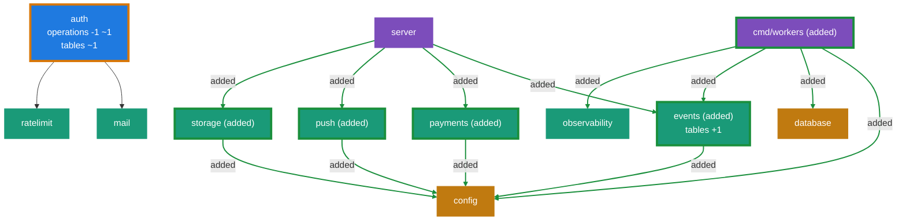

<!-- archmodel-diff -->
### Architecture diff
modules +5 · dependencies +12 · operations -1 ~1 · tables +1 ~1

**Modules**
- added `cmd/workers` (Composition root)
- added `events` (Infrastructure)
- added `payments` (Infrastructure)
- added `push` (Infrastructure)
- added `storage` (Infrastructure)

**Dependencies**
- added `cmd/workers` -> `config`, `database`, `events`, `observability`
- added `events` -> `config`
- added `payments` -> `config`
- added `push` -> `config`
- added `server` -> `events`, `payments`, `push`, `storage`
- added `storage` -> `config`

**Operations**
- removed `POST /auth/verify/resend` (resendVerification, owner `auth`)
- changed `POST /auth/verify` (verifyEmail): rate limit changed

**Tables**
- added `outbox` (6 columns)
- `auth_tokens` columns: -`attempts`

Changed subgraph as Mermaid (text version)

