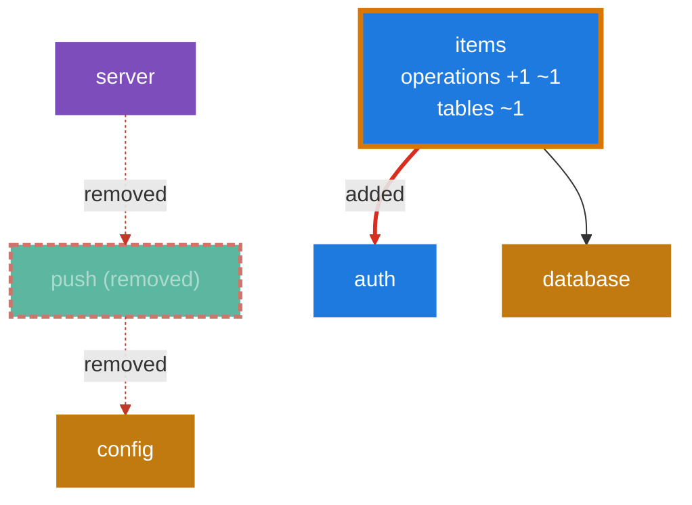

<!-- archmodel-diff -->
### Architecture diff
1 new violation · modules -1 · dependencies +1 -2 · operations +1 ~1 · tables +1 ~1

**New violations**
- **no_domain_to_domain** `items -> auth`: Each Domain is a self-contained vertical slice. When one Domain imports another, they can no longer be understood, tested or changed independently, and a feature in one starts to hide inside the other. *Fix:* Declare a small interface in the consuming Domain describing only what it needs, and have the Composition root wire the other Domain into it.

**Modules**
- removed `push` (Infrastructure)

**Dependencies**
- added `items` -> `auth`
- removed `push` -> `config`
- removed `server` -> `push`

**Operations**
- added `POST /items/{id}/archive` (archiveItem, owner `items`)
- changed `POST /items` (createItem): security: bearerAuth -> public

**Tables**
- added `widgets` (3 columns)
- `items` columns: +`archived_at`

Changed subgraph as Mermaid (text version)

